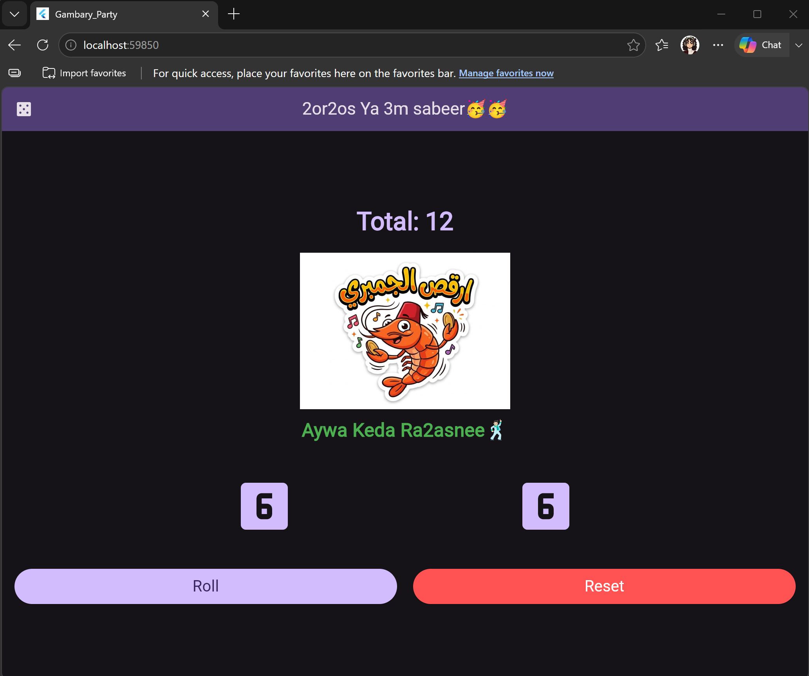
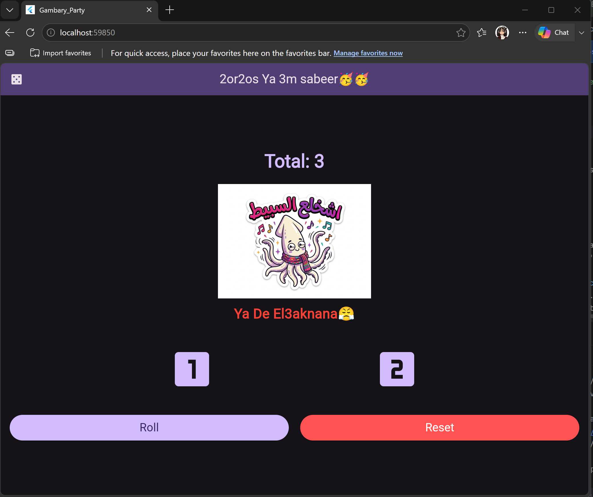

# 🎲 Dice Game - Gambary Party 🦐🦑

A fun and interactive Dice Game built with Flutter for the Mobile Development assignment.

##  About The App
The user rolls two dice to test their luck. If the total of the two dice is **10 or more**, the user wins and a happy/dancing image (Gambareee) is displayed. If the total is less than 10, the user loses and a sad image (Sobeet) is shown.

##  Features
- **Custom Widgets:** Uses a separate `Dice` widget to follow clean code practices.
- **State Management:** Fully functional `StatefulWidget` to handle UI updates (Rolling and Resetting).
- **Custom UI:**
    - Dark Theme implemented using `ColorScheme`.
    - Customized `ElevatedButton` styling.
    - Dynamic `Text` styling using `Theme.of(context).textTheme`.

## 📸 Screenshots

|   🥳 Win State (Total >= 10)   |   😤 Lose State (Total < 10)    |
|:------------------------------:|:-------------------------------:|
|  |  |

